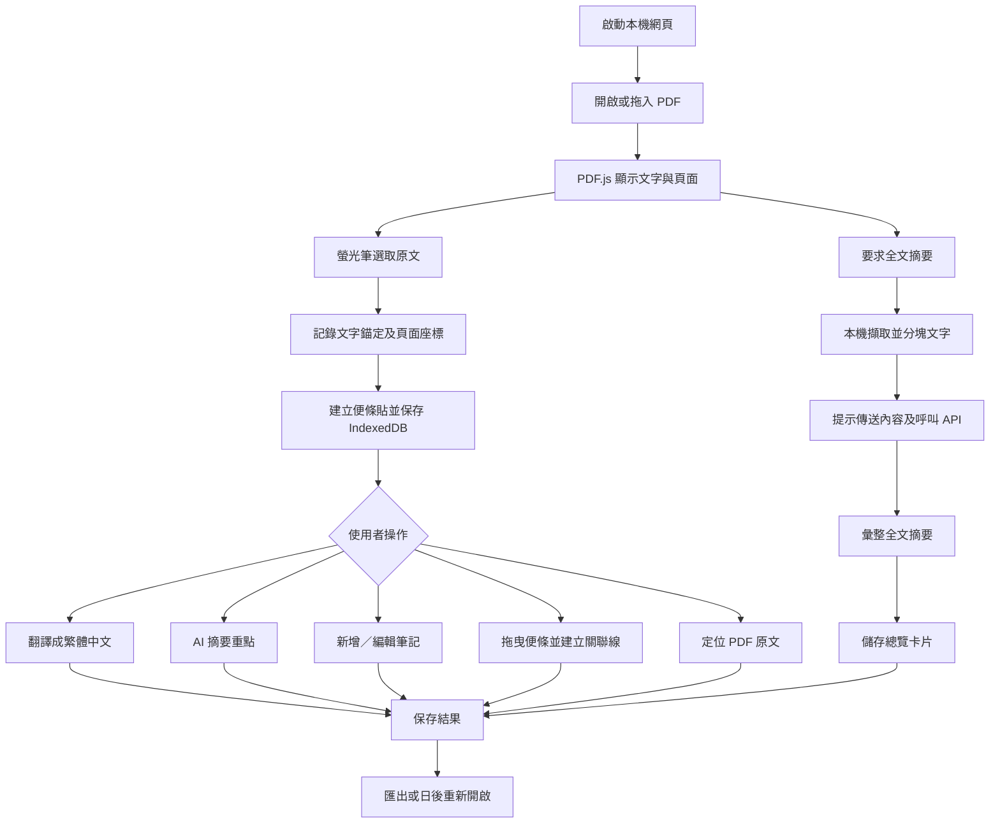

# PDF AI Research Canvas｜本機 AI 文獻閱讀與無邊際知識白板系統規格書

- **文件版本**：v1.0（規劃草案）
- **日期**：2026-10-18
- **開發定位**：供 Codex / 開發團隊直接拆解任務的產品與技術規格
- **目標環境**：桌面 Chrome / Edge 優先；Windows、macOS、Linux；本機執行
- **介面語言**：繁體中文優先，保留英文介面擴充能力

## 1. 專案概述

### 1.1 目標

提供研究者一套「讀 PDF → 標記重點 → 生成便條貼 → AI 翻譯／摘要 → 在無邊際白板組織知識 → 保存、再編輯及匯出」的工具。使用者自行提供 OpenAI 或 Google AI Studio（Gemini API）的 API Key 並選擇模型。

### 1.2 設計原則

1. **Local-first**：PDF、原文標記、便條內容、節點位置和關聯線預設保存在使用者電腦。
2. **人在迴路中**：AI 結果可編輯且不覆蓋 PDF 原文；翻譯與摘要需區分來源文字及 AI 解讀。
3. **雙向定位**：從 PDF 的螢光標記找到白板便條；從便條一鍵跳回 PDF 原始段落。
4. **API 服務供應商可替換**：透過 provider adapter 隔離 OpenAI、Gemini 差異。
5. **無 API Key 仍能使用**：本機 PDF 閱讀、標記、手寫筆記、連線、匯入匯出均可離線完成；AI 功能須網路。
6. **不破壞原檔**：註記保存在專案資料，不直接改寫使用者原 PDF。

### 1.3 本機執行的定義

採「React/TypeScript HTML 前端 + 僅綁定 127.0.0.1 的 Node.js 輕量服務」；瀏覽器開啟本機網址。HTML 前端本機運作，PDF/白板資料在 IndexedDB，Node 程序代理雲端 API 呼叫。預設無遠端資料庫、帳號登入或同步服務。**本機執行不代表 AI 推論完全離線**：使用外部 API 時，經使用者同意會將選定文字或 PDF 內容傳至供應商。

## 2. 主要使用情境

- **UC-01 閱讀並標記**：匯入本機 PDF，在 PDF 中以黃色螢光筆選取跨行文字，完成後新增一張帶有原文、頁碼、顏色與定位資訊的白板便條。
- **UC-02 翻譯**：點便條「翻譯成中文」，使用當前模型產生繁體中文翻譯，保留英文原文及可編輯翻譯。
- **UC-03 摘要**：點便條「AI 摘要」，產生 1–3 句摘要，保留結果、狀態、模型與生成時間。
- **UC-04 全文摘要**：點「全文 AI 摘要」，自動分段處理長篇 PDF，產出研究背景、研究問題、方法、資料/實驗、主要結果、限制、貢獻，引用來源頁碼或段落；結果可做成白板總覽節點。
- **UC-05 建立關聯**：將便條移到白板不同位置，由卡片錨點拖拉連線，標記支持、對比、延伸、因果假設、一般關聯，必要時附文字說明。
- **UC-06 回到來源**：按任一便條「定位原文」，PDF 自動跳頁、捲動並聚焦先前螢光標記。
- **UC-07 中斷後恢復**：關閉瀏覽器再回來，PDF、便條、連線及白板視角仍保留。
- **UC-08 匯出與備份**：匯出 Markdown 筆記和包含 PDF、metadata、所有註記／節點／連線的研究封裝檔。

## 3. UI／UX 規格

### 3.1 全域頂部工具列

- 專案名稱（可編輯）、新增／開啟 PDF、儲存狀態、匯出。
- Provider 選擇 `OpenAI | Google Gemini`，模型下拉選擇、連線狀態、設定齒輪。
- 「全文摘要」按鈕；執行前提示傳送範圍（擷取文字／整份 PDF）、預期成本可能因模型與內容而變動。
- 使用者在設定視窗輸入該服務的 API Key（遮蔽輸入），提供「測試連線」、「清除此 Key」、「更換 Key」。

### 3.2 左側：PDF Viewer（桌面預設 55%，可拖拉至 30–75%）

- 拖拉 PDF 至區域或點按鈕選擇本機檔案。
- 顯示 PDF、多頁連續捲動、上一頁／下一頁、頁碼跳轉、縮放、搜尋文字、適合寬度。
- 工具列：選字模式／螢光筆模式；顏色（黃、綠、粉、藍）；取消目前操作。
- 螢光筆模式選取一段文字，鬆開滑鼠後**立即建立一筆 Highlight 並自動新增一張 Note**；用 Toast 提示「已新增便條」，無需再次確認。空選取不建立。
- 跨多行的同一段選取形成一個 Highlight / Note；跨頁選取第一版提示分頁分別標記，不 silently 建立錯誤範圍。
- PDF 上標記可以點擊：反向聚焦該便條、展開卡片；Delete 操作明確區分「刪除螢光標記和綁定便條」與「只移除卡片視圖」，避免誤刪筆記。
- 標記是 UI overlay；PDF 原檔不直接修改。

### 3.3 右側：無邊際知識白板（桌面預設 45%）

- 支援平移、縮放、框選多卡、拖曳便條、收合卡片、刪除、重命名、Undo/Redo、MiniMap、回到全貌。
- 新卡片以視窗目前可見區域的中心附近錯位排列，不疊在既有卡片上；卡片初始寬度約 280–340px（可調）。
- 卡片以原文、翻譯、AI 摘要、使用者筆記四個區塊呈現；預設只展開原文片段，其他區塊按需顯示。
- 卡片頂部顯示色條、簡短標題、頁碼與對應 PDF。底部動作：`翻譯`、`AI 摘要`、`定位原文`、`編輯`、`更多`。
- 連線：從卡片四邊的連接點拖到其他卡片；可選標籤「相關／支持／對比／延伸／待驗證」，可編輯線上說明；預設無方向，必要時切換箭頭。
- 卡片可手動新增（不綁定 PDF 標記），用於「個人想法」「研究假說」「整篇總結」。
- 連線、卡片的編輯自動儲存；白板視圖位置與縮放比例分開儲存。

### 3.4 雙向同步

- `PDF Highlight → Note`：每個被接受的選取產生唯一 noteId，存入 highlight.noteId。
- `Note → PDF Highlight`：點「定位原文」跳到該 PDF 頁碼，等待 PDF page render 完成後捲至 highlight 範圍並短暫加上強調外框。
- `PDF Highlight → 白板 Node`：點標記自動找出 noteId，平移白板讓該 Note 居中並閃爍外框。
- 無關聯手動 Note 的「定位原文」隱藏／停用。

## 4. 功能需求與優先級

| ID | 功能 | 優先級 | 規格與驗收要點 |
|---|---|---|---|
| FR-01 | 本機 PDF 匯入與顯示 | P0 | 支援一般文字型 PDF，拖拉或選取檔案；顯示頁碼、縮放；原文可選取 |
| FR-02 | 螢光筆與精準錨定 | P0 | 跨行標註可儲存，重新開啟及縮放後還原到正確字元位置 |
| FR-03 | 自動產生便條貼 | P0 | 每次有效標記建立一張且僅一張卡片，包含來源及原文 |
| FR-04 | 無邊際白板 | P0 | 平移、縮放、卡片拖曳、連線、刪除、儲存位置 |
| FR-05 | PDF↔卡片雙向定位 | P0 | 互點後聚焦唯一且正確的標記／便條 |
| FR-06 | OpenAI / Gemini Key 與模型 | P0 | 可測試、切換、顯示錯誤；未設 Key 可使用離線功能 |
| FR-07 | 單卡 AI 翻譯 | P0 | 英文→繁體中文；保留原文；回傳不取代人工筆記 |
| FR-08 | 單卡 AI 摘要 | P0 | 精簡重點，失敗可重試，不覆蓋舊版本直到成功 |
| FR-09 | 全文 AI 摘要 | P0 | 長文分塊摘要／聚合；有章節化輸出、來源頁碼與不確定性註記 |
| FR-10 | 本機持久化 | P0 | IndexedDB 保存 PDF blob、註記、卡片、連線、設定（不保存明文 Key） |
| FR-11 | Markdown / JSON 匯出 | P1 | 有來源頁碼及連線關係；JSON schemaVersion；可重新匯入 |
| FR-12 | 封裝匯出／還原 | P1 | .zip 或自定 `.researchpack` 包含 PDF + manifest + annotations，跨電腦還原 |
| FR-13 | 多 PDF 專案 | P1 | 一專案多文獻；每張卡片顯示來源文件；切換 PDF |
| FR-14 | 使用者筆記、分類與搜尋 | P1 | 支援自由輸入、標籤、按標籤或全文搜尋便條 |
| FR-15 | 掃描 PDF/OCR | P2 | 可選 OCR（本機或明示雲端）；區分 OCR 文字與原生文字層 |
| FR-16 | 跨 PDF 間知識連線 | P2 | 不同論文便條可以連線、篩選及建立主題群組 |
| FR-17 | AI 建議便條關聯 | P2 | AI 提供建議但不自動拉線，需使用者採納 |
| FR-18 | 知識圖／投影片輸出 | P2 | 白板 PNG/SVG、研究簡報輸出 |

**P0 必須構成完整可用的研究閉環**，不可僅完成畫面 demo。

## 5. 高精度標記資料設計

### 5.1 為何不能只記錄螢幕像素

PDF 在不同視窗寬度與縮放倍率時，畫面像素位置會改變。資料必須保存可還原的**文件座標 + 原始文字定位**，不可只存 mouseX/mouseY。

### 5.2 Highlight 必要欄位

- `id`, `documentId`, `noteId`, `pageIndex`（程式 0-based）／`displayPage`（顯示 1-based）。
- `selectedText`（原文快照），`prefix`、`suffix`（定位上下文），`textQuoteHash`。
- `textRange`：文字層 start/end item 或 span 的 offset，僅作快速路徑，避免依賴 PDF.js 不穩定 DOM index。
- `quads`：每個矩形在 PDF page viewport **正規化座標 0..1** 或原生 PDF 座標中的 bounding rectangle／quad，儲存座標系與頁面 rotation。
- `color`, `createdAt`, `updatedAt`, `schemaVersion`。

**錨定策略**：優先重建 PDF.js 文字層 range/quote，配合 `prefix/suffix` disambiguation，再校對 PDF page coordinates/quads。重繪 overlay 時依 viewport 轉換。若失敗標記 `unresolved`，提示使用者重新定位；不要靜默移到錯誤字句。

### 5.3 特殊案例

- 同一原文多次標註：不同使用者動作可形成不同 Highlight；連續重複觸發同一 selection event 不可誤新增重複卡片。
- 重複單字在同頁：以文字上下文與 quads 區分。
- 複製文字含換行、斷字：保留 rawText 與 normalizedText，AI 可用 normalizedText；PDF 顯示錨定仍以 raw selection 為準。
- 兩欄論文：依 PDF.js TextLayer 的實際選取範圍，不用整頁線性排列猜測。
- 旋轉頁、縮放與非等比例窗口：標記重算位置。
- 無文字層掃描 PDF：第一版仍可觀看，但停用精準選字並提示「此文件需要 OCR 才能文字標註」。

## 6. AI 功能規格

### 6.1 Provider adapter

前端應使用統一介面：`testConnection()`、`listModels()`、`translate(text, context)`、`summarizeSelection(text, context)`、`summarizeDocument(chunks, metadata)`。服務商差異由後端 adapters 實作；UI 與資料庫不直接耦合。

- **OpenAI**：文字生成以 Responses API 為主要實作；適用情況可送 PDF 作 `input_file`；模型需確認可用、支援所需輸入能力與該 Key 的權限。
- **Google AI Studio**：使用 Gemini API 正式受支援的內容生成接口；可送擷取文字，或按需使用 PDF 原生文件輸入／Files API。
- 模型清單由官方 Models API 動態抓取、快取，標示「適合文字任務」「支援 PDF」「未驗證」等能力；不可假設 listModels 內所有模型都能成功完成摘要。允許手動輸入模型 ID，連線與功能測試失敗要顯示可讀原因。
- 服務商連線失敗分類：無效 Key、額度不足／429、模型無權限、網路失敗、檔案超限、內容過長、超時。
- 不預設宣稱某服務免費；由使用者自行承擔供應商計費。

### 6.2 單卡翻譯輸入與輸出

**輸入**：使用者選取的原文，以及有限的同段落上下文（例如前後各 1–2 句）。

**要求**：翻譯成自然、忠實的繁體中文；保留引用編號、數值、縮寫及重要專有名詞，不新增原文未提及的結果。

**輸出**：`translatedText`, `provider`, `model`, `status`, `createdAt`，可手動修訂；單卡重試時保留先前成功內容直到新內容成功提交。

### 6.3 單卡摘要

**輸入**：原文為主，使用者選取的段落附近上下文可選；如果長度不足以推論，明確指出。

**輸出**：用 1–3 句繁體中文說明本段核心論點、方法／發現及必要限制；不推論文中不存在的數值。

### 6.4 全文摘要／長文處理

1. 本地 PDF.js 擷取各頁文字及頁碼。先檢查空白頁、疑似掃描 PDF、頁面數、字量。
2. 預設採**本機文字萃取 + 分塊摘要**以減少不必要的 PDF 上傳。每塊保存頁碼起訖，建議按段落／標題切片，並保留少量 overlap。
3. 模型對每個 chunk 產出結構化局部摘要，標記可追溯頁碼；再進行跨 chunk 統整（map-reduce）。
4. 大量圖表資訊是必要研究結論時，可改走支援 PDF 圖像理解的模式，且必須先告知使用者傳送整份 PDF/頁面圖片。
5. 最終輸出：文獻資訊（可辨識時）、研究背景、研究目的／假說、方法、資料與實驗設計、主要結果、限制、貢獻、可延伸研究，以及「需自行核對」提示。
6. 摘要要有來源頁碼。頁碼僅代表 chunk 原始範圍，**不是模型已驗證的精準引用**；對具體論斷應優先回查頁面或已標記文字。
7. 摘要失敗可由中斷 chunk 重跑，不得清除已完成標註；提供取消、進度、重試、用量／成本資訊（供應商回傳才顯示精確值，否則標記估計）。
8. 全文摘要以「總覽卡片」存至白板，由使用者決定連向哪些段落，避免自動建構未證實的因果關係。

### 6.5 Prompt 與 AI 信任邊界

- PDF 內容、便條內容都視為**不可信文字資料**；即使文獻內出現「忽略先前指示」字串，也不能讓它變更系統設定或執行其他操作。
- Prompt 要求「僅使用提供文字／圖像，不確定請明言，不要捏造實驗數據或引用」。
- 不把 API Key、作業系統檔案路徑、其他未選取文件或所有專案資料放入生成 Prompt。
- AI 回應做為純文字／經過安全轉譯的 Markdown 呈現，不將模型輸出當 HTML 執行。

## 7. 白板節點與關聯設計

**節點種類**：`highlight-note`（PDF 來源）、`manual-note`（自由研究筆記）、`document-summary`（全文摘要）。

**連線模型**：`edgeId`, `workspaceId`, `sourceNoteId`, `targetNoteId`, `relationType`, `label`, `direction`, `createdAt`, `updatedAt`。

**關聯類型**：一般相關、支持、對比、延伸、待驗證；由使用者選擇且可更改。以免將主觀連線當成研究結論，匯出資料需保留「人工建立」與選填的說明。

**操作**：拖曳點對點、單擊 edge 選取、Delete 移除、編輯文字標籤、連線跟隨卡片移動、Undo/Redo。卡片和連線獨立建模；刪除連線不影響卡片或 PDF 螢光標記。

## 8. 本機資料儲存／版本控制

### 8.1 IndexedDB 物件集合

- `workspaces`: id、名稱、建立時間、更新時間、activeDocumentId、viewport。
- `documents`: id、workspaceId、name、sha256、fileSize、mimeType、pageCount、pdfBlob、頁面文字索引、createdAt。
- `highlights`: id、documentId、noteId、pageIndex、selectedText、prefix、suffix、quads、color、status。
- `notes`: id、workspaceId、documentId?、highlightId?、type、title、originalText、translatedText、aiSummary、userNotes、tags、x、y、width、collapsed、color、updatedAt。
- `edges`: id、workspaceId、sourceId、targetId、relationType、label、direction。
- `ai_runs`: id、taskType、noteId?、documentId?、provider、model、status、createdAt、tokenUsage?、errorCode?；**不得存 API Key 或完整授權標頭**。
- `preferences`: 介面與非秘密設定（最後選擇的 provider／model、側欄比例等）。

### 8.2 儲存規則

- IndexedDB 寫入採 transaction 保證 Highlight + Note 綁定一致；建立筆記與螢光標記不得只成功一半。
- 適當 debounce 白板拖拉存檔，結束拖曳後立即存一次；每次文字編輯在失焦時確認落盤。
- DB schema version + migration；遇到資料庫升版先備份提示；自動備份非永久保證，需提供定期下載封裝。
- `sha256` 辨識相同 PDF；同 hash 可要求使用者選擇開啟原專案或建立新專案，避免誤覆蓋。
- API Key 預設僅存在本機代理服務的記憶體及當前程序 session，不保存到 IndexedDB、LocalStorage、檔案、log、備份或匯出。
- 若日後提供「記住 Key」，必須另做系統鑰匙圈／加密憑證保存，不列為 P0。

### 8.3 封裝格式（P1）

`researchpack.zip` 預計結構：

```text
researchpack.zip
├── manifest.json            # schemaVersion、workspace、文件索引
├── documents/
│   └── <documentId>.pdf
├── annotations.json         # highlights / notes / edges / viewport
└── README.txt               # 版本及隱私提醒
```

不得包含 Key、秘密 token、未經選取的其他本機檔案。匯入先驗 schema、checksum、檔名路徑及 zip bomb 風險。

## 9. 本機 API 服務與介面合約

建議 `localhost` Node.js server 提供：

| Method | Endpoint | 功能 |
|---|---|---|
| `POST` | `/api/session/key` | 透過同源本機請求將指定 provider 的 Key 放進本機程序記憶體 |
| `DELETE` | `/api/session/key/:provider` | 清除指定金鑰 |
| `POST` | `/api/providers/test` | 測試 API Key / 服務連線 |
| `GET` | `/api/providers/:provider/models` | 取得該 Key 可見的模型列表和必要的過濾資訊 |
| `POST` | `/api/ai/translate` | 單段翻譯，輸入 noteId / text / context / provider / model |
| `POST` | `/api/ai/summarize-selection` | 單段摘要 |
| `POST` | `/api/ai/summarize-document` | 全文摘要，使用前端傳入的指定文本 chunks／可選 PDF；使用 jobId 回報進度 |
| `POST` | `/api/ai/cancel/:jobId` | 盡可能取消進行中的任務 |
| `GET` | `/api/health` | 本機啟動狀態 |

接口約定：回傳 `{ok, data?, error?:{code,message}, requestId?}`；AI 任務包含 `provider, model, status, result, usage?`。服務不能提供任意外部網址轉發功能或暴露 Key。任務執行期間切換 provider/model，舊任務應繼續綁定送出時的選項，避免結果標記錯誤。

**安全要求**：只 listen `127.0.0.1`；HTTP 同源服務前端；檢查 `Origin`、CSRF／會話 token 及本機 Host；不對區域網路開放；關閉 CORS 通配；上限速率／請求尺寸；Key 打碼；禁用可被 PDF 原文觸發的工具呼叫；在 UI 顯示「你將傳送哪些資料」。本機服務預設單人、單機使用；未設計給多人共用一個 port 存取。

## 10. 專案結構建議

```text
pdf-ai-research-canvas/
├── README.md
├── package.json
├── apps/
│   ├── web/                     # Vite + React + TypeScript
│   │   └── src/
│   │       ├── components/pdf/  # PdfViewer, HighlightLayer, TextSelection
│   │       ├── components/board/# ResearchCanvas, NoteNode, RelationEdge
│   │       ├── components/ai/   # Settings, AIProgress, SummaryPanel
│   │       ├── db/              # Dexie schema & migration
│   │       ├── stores/          # state management
│   │       ├── features/        # document/annotation/note/edges
│   │       └── types/
│   └── local-server/            # Node.js / Express or Fastify
│       └── src/
│           ├── adapters/openai.ts
│           ├── adapters/gemini.ts
│           ├── routes/
│           └── security/
├── packages/shared/            # schemas, common types, prompt templates
└── tests/                      # unit/integration/e2e, fixtures
```

非必要時避免增加向量資料庫、登入系統、雲端 DB、複雜微服務或協作同步，以便先把 PDF ↔ 白板 的完整閉環做穩。

## 11. 使用者流程



## 12. 非功能需求

- **資料隱私**：PDF 及標註保留本機；沒有使用者動作不得自動將檔案傳至 AI API。雲端任務應在設定與送出時清楚標示內容型態與對象。
- **可用性**：載入 100 頁文字型學術 PDF 不需要預先渲染全部頁面，採按需 rendering；白板 100 張卡片仍能順暢拖曳為測試目標（實際效能視硬體）。
- **相容性**：Chrome、Edge 最新穩定版；對 Firefox、Safari 以 P1 測試補足。
- **例外恢復**：切換 provider、API timeout、部分 chunk 失敗、Key 無效、瀏覽器斷線時，不可造成原有標註與便條消失。
- **可及性**：基本鍵盤操作、聚焦狀態、色彩不單靠顏色表達標記意義。
- **記錄**：一般操作與 AI 的錯誤代碼可記錄在瀏覽器 debug 模式，但絕不記錄 API Key 或整份文獻的明文 HTTP body。
- **操作確認**：大量刪除專案／白板時需要確認；建立標註、新增便條和一般連線不需確認。

## 13. 驗收測試（最小可交付標準）

| 測試 | 操作 | 預期結果 |
|---|---|---|
| AT-01 | 開啟 20 頁含雙欄的文字 PDF | PDF 正確呈現，可閱讀／跳頁／縮放 |
| AT-02 | 螢光筆跨 3 行選字 | 一筆標記，一張便條，不重複建立 |
| AT-03 | 放大 PDF 至 150% 再縮回 | 標記仍覆蓋原先正確字句 |
| AT-04 | 存檔後關閉重新開啟 | 仍看到 PDF、標記、卡片、連線、位置 |
| AT-05 | 點便條「定位原文」 | 頁碼正確且原文標記進入視野 |
| AT-06 | 點 PDF 螢光標記 | 白板聚焦對應便條 |
| AT-07 | 分別設定兩服務 Key 並測試 | 可獨立選擇及切換，不洩漏任一 Key |
| AT-08 | 斷線／無 Key 點 AI 翻譯 | 顯示可理解錯誤，保留原文與便條 |
| AT-09 | 翻譯與摘要同一便條 | 兩種生成結果分欄保存，原文不變 |
| AT-10 | 對長篇 PDF 執行全文摘要 | 顯示進度、產生結構化摘要且保留頁面來源範圍 |
| AT-11 | 移動便條再拉線 | 線端跟隨便條且重開後還原 |
| AT-12 | PDF 為純掃描頁 | 顯示 PDF 並提示不支援文字標註，不能產生空便條 |
| AT-13 | 結束本機服務後重啟 | 原有金鑰不自動恢復，非秘密閱讀資料仍存在 |
| AT-14 | 匯出 JSON/Markdown（P1） | 帶有來源頁碼、原文與關聯資訊；可正確再次匯入 |

## 14. 分階段開發

### Phase 1｜閱讀、標註、白板主流程（P0）
- 搭建 React + Vite + Node local server。
- PDF.js 顯示、選字螢光筆、精準 anchor + overlay。
- 反向連結的便條貼、React Flow 卡片與連線、IndexedDB 永久保存。
- 完成 AT-01～AT-06、AT-11～AT-12。

### Phase 2｜AI 與全文摘要（完成 P0）
- OpenAI / Gemini adapter、Key session、安全代理、模型清單。
- 單卡翻譯／摘要；長 PDF 分塊摘要及總覽卡片；錯誤處理與取消。
- 完成 AT-07～AT-10、AT-13。

### Phase 3｜可攜備份與研究效率（P1）
- Markdown／JSON／ResearchPack 匯出匯入、多 PDF 工作區、全文筆記搜尋及標籤。
- 改善鍵盤快捷鍵、批次選取、undo/redo、遷移和資料完整性。

### Phase 4｜研究深化（P2）
- 掃描 PDF OCR、跨文獻引用網路、AI 關係建議、研究圖表／簡報匯出。

## 15. 暫不納入第一版

- 使用者帳號、跨裝置同步、多使用者即時共同編輯。
- 在雲端儲存 PDF、鑰匙串永久保存 Key、付費訂閱和金流。
- 自動引用驗證、全自動畫研究因果圖、精準處理所有掃描式/加密 PDF。
- 大型知識庫 RAG/向量搜尋；先以單篇全文摘要與可追蹤選段為目標。

## 16. 開發重要風險與待驗證項目

1. **PDF 文字定位**：PDF.js 的文字層 DOM 結構可能隨版本改變，需要以文字 quote + document coordinates 做雙重錨定，提供大量 PDF fixture 測試。
2. **AI 費用／上限**：直接送 PDF 可能包含頁面圖片 token，成本較高；長篇文章預設 text-chunk summarize 並提供 PDF 原生理解選項。單一供應商可能有模型／檔案大小限制，交給 adapter 檢查而非假設通用。
3. **模型列表的能力判別**：官方 models endpoint 不保證給出完整任務能力；需可維護的 provider capability 設定及實測。
4. **安全**：本機代理不能誤綁 `0.0.0.0`，不能任意代理使用者 URL，Key 不得出現在 HTML bundling、log、DB、匯出檔。
5. **儲存空間**：IndexedDB 容量由瀏覽器決定；多大型 PDF 專案需明示容量、匯出備份，後續可擴充 File System Access API。
6. **OCR 與表格**：純文字擷取可能遺失圖表、兩欄順序、公式結構；要提供模式切換與明顯提示，而非讓摘要悄悄失真。

## 17. 官方文件與技術參考（2026-10-18 查核）

- Mozilla PDF.js：https://mozilla.github.io/pdf.js/getting_started/
- React Flow：https://reactflow.dev/ ；授權：https://xyflow.com/open-source
- OpenAI File Inputs：https://developers.openai.com/api/docs/guides/file-inputs
- OpenAI API Key 安全：https://help.openai.com/en/articles/5112595-best-practices-for-api-key-safety
- OpenAI Models API：https://developers.openai.com/api/reference/resources/models/methods/list
- Gemini API 文件理解：https://ai.google.dev/gemini-api/docs/document-processing
- Gemini API Key 安全：https://ai.google.dev/gemini-api/docs/api-key
- Gemini Models API：https://ai.google.dev/api/models
- IndexedDB：https://developer.mozilla.org/en-US/docs/Web/API/IndexedDB_API

---

**架構決策摘要**：第一版完成「PDF 標記位置精準還原 + 自動建立便條 + 白板拉線 + 本機保存 + OpenAI/Gemini 翻譯與摘要 + PDF 全文摘要」七項核心能力，優先保障資料正確性，再擴展跨文獻研究知識圖。
