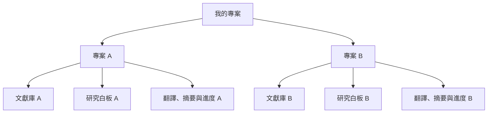

# PaperReader 多專案管理與切換｜開發規格書

- 文件版本：v1.0
- 日期：2026-10-20（Asia/Taipei）
- 狀態：待實作；本文件本身不代表功能已完成。
- 用途：交付 Codex 進行產品、資料層、介面與測試修改。
- 程式檢視基準：Git `05e7bf3` 及撰寫當下的工作目錄；實作前仍須檢查最新程式與未提交變更。
- 相關文件：[交接文件](交接文件.md)、[README](README.md)。舊系統規格中的後端代理等歷史設計，不適用本次功能。

## 1. 開發目標

目前 PaperReader 只有一個研究空間。使用者希望把「現在整個畫面」視為一個專案，建立多個彼此獨立的專案，並透過獨立專頁切換整份研究。

完成後的主要流程：

1. 開啟 PaperReader，進入「我的專案」。
2. 建立新專案，或從清單進入既有專案。
3. 進入現有的文獻庫、PDF 閱讀器與研究白板。
4. 返回「我的專案」，切換另一份研究。
5. 再次進入原專案時，內容與閱讀位置仍可恢復。

例如「AI 輔助學習研究」與「醫學教育文獻回顧」各有自己的 PDF、便條、標註、連線、翻譯與摘要進度。切換其中一個專案，不會改變另一個專案的研究內容。

## 2. 名詞與現況

### 2.1 專案的定義

一個專案對應一份完整 `Workspace`，包含一個文獻庫與一張研究白板。可以為同一專案開啟多個閱讀視窗與白板視窗；多個白板視窗觀看的是同一張白板的不同位置。

本次不增加「同一專案內有多張獨立白板」的功能。



### 2.2 已核對的程式基礎

| 現況 | 本次開發的影響 |
| --- | --- |
| `src/types.ts` 的 `Workspace` 已有 `id`、`title` 及完整研究集合 | 可沿用研究內容模型 |
| Dexie 資料庫為 `PaperReader`，目前資料庫版本為 6 | 需要資料庫升級與遷移 |
| 研究內容存在實體表 `workspacesV2`，程式用 `db.workspaces` 別名 | 目前只讀取 `default` |
| PDF 在 `documents`，截圖在 `assets`，主鍵均只有附件 ID | 多專案需增加附件歸屬與複合主鍵 |
| `sync`、待存佇列、復原歷史與 `drafts` 目前按單一研究空間運作 | 都必須辨識專案 |
| 視窗通知共用 `PaperReader.windows.v1` | 需升級通訊格式並隔離專案 |
| 全文摘要、PDF 段落辨識與逐段翻譯使用全站任務鎖 | 需改為每個專案各自互斥 |
| `restoreImport()` 強制把匯入內容的 ID 改成 `default` | 需拆分「匯入新專案」與「還原目前專案」 |
| `holdWindowStorage()` 只根據目前單一研究空間回收圖片 | 多專案下需保護所有專案的附件 |
| 工作區／備份內容版本為 `schemaVersion: 2` | 與 Dexie 資料庫版本分開管理 |

## 3. 本版產品決策

以下是本規格採用的開發預設，實作時依此完成，不需要為一般介面或命名選擇另外停工詢問。

| 項目 | 本版行為 |
| --- | --- |
| 一般首頁 | 「我的專案」專頁，列出所有可用專案 |
| 新安裝 | 顯示空狀態，不自動建立空白研究 |
| 舊使用者升級 | 把既有研究保留為第一個專案，不要求重新匯入 |
| 建立專案 | 輸入名稱，成功建立後直接進入 |
| 專案名稱 | 去除頭尾空白後 1–100 字元；可重名；以 ID 辨識 |
| 專案切換 | 同分頁前端導航；先保存，再離開；不強制整頁重新載入 |
| 多視窗 | 各自綁定專案，可同時開啟不同專案 |
| 同一 PDF | 可以放在不同專案；標註與研究內容各自獨立 |
| 匯入研究備份 | 預設建立新專案，不覆蓋目前研究 |
| 清空資料 | 專案內改為「清空目前專案」，保留專案名稱與 ID |
| AI 偏好與金鑰 | 供應商、模型、推理偏好沿用現有共用偏好；金鑰仍只在原分頁記憶體 |
| 儲存與部署 | 沿用 IndexedDB、GitHub Pages 與 PWA，無新增後端或登入 |

專案數量不先設定任意的小型硬上限，但所有專案共同使用目前網站來源的瀏覽器儲存空間。既有每專案文獻數、單檔大小與封裝大小限制維持，以實作當下的程式為準。

## 4. 功能範圍

### 4.1 本版必須完成

- 專案總覽、空狀態、載入與錯誤狀態。
- 建立、進入、返回總覽、切換、重新命名與刪除專案。
- 依名稱搜尋；依最後修改時間預設排序，並可改為名稱排序。
- 專案卡片顯示名稱、PDF 數、便條數與最後修改時間。
- 記住各專案的閱讀位置、白板視角與面板配置。
- 研究內容、附件、同步、草稿、任務與復原紀錄的專案隔離。
- 舊資料自動遷移；舊版 v1／v2 備份仍能匯入。
- 單專案匯出、匯入為新專案、還原目前專案與清空目前專案。
- 桌面、手機、多視窗與離線使用回歸驗證。
- 更新 README、使用說明及交接文件。

### 4.2 本版不納入

- 登入、雲端儲存、跨裝置同步、多人協作與權限管理。
- 專案資料夾、封存、釘選、自訂封面與描述欄位。
- 複製整個專案、跨專案搬移便條、跨專案搜尋及合併研究。
- 全部專案一次匯出與全部專案一鍵刪除。
- 跨專案附件去重、共用文獻庫與一專案多張獨立白板。
- API Key 長期保存、OCR、AI 圖片分析及更換 AI 服務介面。

## 5. 介面與操作規格

### 5.1 我的專案

沿用目前 PaperReader 的色彩、字型、按鈕與卡片語言。總覽使用完整頁面，不以文獻庫側欄或小型對話框取代。

```text
PaperReader                         連接你的 AI   使用說明

我的專案                                  ＋ 建立專案
把不同研究分開整理，隨時接續閱讀。

[ 搜尋專案名稱… ]                     [ 最後修改 ▼ ]

┌────────────────────┐  ┌────────────────────┐
│ AI 輔助學習研究    ⋯│  │ 醫學教育文獻回顧  ⋯│
│ 3 篇 PDF · 18 張便條│  │ 5 篇 PDF · 32 張便條│
│ 最後修改：日期時間  │  │ 最後修改：日期時間  │
│ 進入專案 →         │  │ 進入專案 →         │
└────────────────────┘  └────────────────────┘

匯入研究封裝 / JSON                 本網站本機使用量
```

- 卡片主區域或「進入專案」可開啟專案；更多選單包含重新命名與刪除，操作不觸發進入。
- 搜尋僅針對專案名稱，忽略英文大小寫與查詢字串頭尾空白。
- 預設依內容 `updatedAt` 由新到舊排序；同時間以穩定順序顯示，避免跳動。
- 沒有專案時顯示「建立第一個專案」及「匯入研究封裝 / JSON」。
- 搜尋無結果時顯示清除搜尋入口，不誤顯示首次使用的空狀態。
- 載入期間不可先顯示零專案再跳出清單；讀取失敗提供重試，不擅自建立空專案。
- 儲存用量若來自 `navigator.storage.estimate()`，標示為整個網站用量，不宣稱是單一專案大小。
- 手機使用單欄卡片，操作按鈕可觸控且沒有水平溢位。
- 總覽不掛載 PDF Viewer 或 React Flow，不讀取每個專案的 PDF Blob 或全文段落。

### 5.2 建立與重新命名

- 建立表單欄位為「專案名稱」，可提供「未命名專案」初值。
- 禁止全空白；超長名稱在欄位內提示；Enter 提交，Esc 取消。
- 建立中停用重複提交；建立失敗不出現半成品卡片。
- 新建專案使用 UUID；建立資料、同步版本及卡片摘要必須是同一筆原子操作。
- 重新命名同步更新工作區與總覽摘要。同專案其他視窗收到通知後更新名稱。
- 專案內原有名稱欄位繼續可編輯，但套用相同驗證與保存規則。
- 重名合法，不以名稱作為檔案、資料表或路由的識別鍵。

### 5.3 專案工作畫面

- 保留目前 PDF 閱讀、文獻庫與白板主要操作。
- 頂部提供可辨識的「我的專案」返回入口，並顯示目前專案名稱。
- 獨立閱讀與白板視窗也顯示所屬專案名稱；瀏覽器標題包含專案名稱與視窗類型。
- 返回總覽視同離開專案，必須走第 8 節的保存與任務停止流程。
- 總覽不能透過 `N`、Ctrl+O、拖放 PDF 或其他全域捷徑改動最後開啟的專案。

### 5.4 刪除與清空

- 刪除專案在總覽更多選單操作，確認視窗包含專案名稱、PDF／便條數及「無法復原，建議先備份」。
- 刪除成功後回到／維持總覽；刪除最後一個專案後顯示空狀態。
- 專案內「清空目前專案」另行確認，清除該專案研究與附件，保留名稱、ID、建立時間，重設內容計數及視角。
- 不再讓專案內的「清除本機資料」直接執行全站附件或草稿的 `.clear()`。
- 刪除與清空均不清除此分頁的 AI 金鑰、其他專案或共用 AI 偏好。

## 6. 路由與視窗歸屬

沿用查詢參數，避免引入 GitHub Pages 需要伺服器重寫的路徑。以下參數組合為本版契約：

| 用途 | URL 查詢參數 |
| --- | --- |
| 一般入口 | 無參數，顯示專案總覽 |
| 專案總覽 | `?view=projects` |
| 專案主畫面 | `?project=<projectId>` |
| 獨立 PDF | `?project=<projectId>&view=reader&document=<documentId>&instance=<uuid>` |
| 獨立白板 | `?project=<projectId>&view=board&instance=<uuid>&x=<x>&y=<y>&zoom=<zoom>` |

- 使用 `URL`／`URLSearchParams` 建構網址，保留網站 base path。
- 同分頁切換使用前端導航，支援上一頁／下一頁；路由變更一律經過離開專案的檢查。
- 不能只在模組載入時解析一次路由；目前 `readerWindow`、`boardWindow` 等靜態參數需配合新的導航生命週期調整。
- 每個視窗各有穩定 `windowId`，專案切換不把其他視窗改到相同專案。
- 重新整理或直接貼上有效網址時，開啟 URL 指定的專案。
- 專案不存在／已刪除時顯示「此專案不存在或已刪除」與返回總覽，不自動建立空專案或默默開啟別的專案。
- 舊網址 `?view=reader&document=...` 或 `?view=board&...` 缺少 `project` 時，僅可對應遷移後的 `default` 專案；沒有該專案時顯示明確提示。不可用「最近專案」猜測歸屬。
- 開新視窗仍須在按鈕事件內同步呼叫 `window.open()`；被阻擋時提供包含正確專案參數的可用連結。

## 7. 資料設計

### 7.1 專案內容與總覽摘要

保留 `Workspace` 作為單專案內容，令 `Workspace.id === projectId`。新建專案不可再共用 `emptyWorkspace()` 內固定的 `default`；既有 `default` 僅作遷移後第一個專案的合法 ID。

總覽另存輕量摘要，避免開首頁就讀取所有專案的頁面文字、段落與譯文。建議型別：

```ts
interface ProjectMeta {
  id: string;
  title: string;
  createdAt: string;
  updatedAt: string;
  documentCount: number;
  noteCount: number;
  lastOpenedAt?: string;
}

interface ProjectContext {
  projectId: string;
  epoch: string;
  generation: number;
}
```

- `noteCount` 計算全部保存的便條，包含已隱藏便條；與是否顯示在畫面分開。
- `updatedAt` 表示研究內容或名稱實際修改時間；純開啟、切換頁面與調整視角不更新它。
- `lastOpenedAt` 可作記錄，但不影響「最後修改」排序。
- 工作區保存與摘要更新須在同一交易，不能先更新卡片再等待研究內容落盤。
- `ProjectMeta.title` 是 `Workspace.title` 的投影，重新命名必須經統一保存入口，避免兩份名稱分歧。

### 7.2 建議資料表

沿用同一個 IndexedDB，建立新的專案資料表。表名可以依實際程式調整，以下主鍵與隔離條件不可省略：

| 資料表 | 主鍵／索引 | 內容 |
| --- | --- | --- |
| `projects` | `id`，索引 `updatedAt`、`title` | 總覽摘要 |
| `projectWorkspaces` | `id` | 完整單專案 Workspace |
| `projectDocuments` | `[projectId+id]`，索引 `projectId` | PDF Blob |
| `projectAssets` | `[projectId+id]`，索引 `projectId` | 截圖 Blob、雜湊 |
| `projectSync` | `id`（即 projectId） | epoch、revision、recent、active／deleted 狀態 |
| `projectDrafts` | `[projectId+id]`，索引 `projectId` | 同步衝突與編輯草稿 |
| `projectViews` | `[projectId+kind]`，索引 `projectId` | 專案最近視角，kind 為主畫面／閱讀／白板 |

- Blob 以複合主鍵隔離，專案內既有 `documentId`、`assetId`、便條與來源 ID 可以保留。
- 把同一份備份匯入兩次，不需要重寫所有內部關聯 ID，也不得互相覆寫附件。
- 讀取、保存、刪除 PDF 與圖片的 API 必須明確接收 `projectId`，例如 `getDocumentBlob(projectId, documentId)`。
- 不只修改 `db.ts`：`ScreenshotImage`、PDF cache、匯入／匯出、擷取後的失敗清理等直接存取附件處也要更新。
- 若保留 `db.workspaces` 等別名，必須確認型別與呼叫端不會再退回單專案預設值。

### 7.3 版本、變更與草稿

- 每筆 `Change`、衝突草稿與任務控制資訊都攜帶 `projectId`；不能在稍後提交時才讀取「現在的專案」決定寫入對象。
- `commitChange()` 以該筆變更的專案 ID，在交易內讀取正確工作區、檢查 epoch、合併欄位並更新 revision 與摘要。
- 保留現有不同欄位合併、同欄位保留草稿、原值比對與操作去重能力。
- 普通切換專案不更換持久化 epoch，也不對其他視窗廣播研究重設。
- 清空、還原與刪除才更換該專案 epoch，舊修改不能寫回。
- 刪除時保留可拒絕舊寫入的 tombstone 或等效機制；已刪除／不存在的專案不可因背景存檔自動重建。
- `loadProject()` 對未知 ID 回傳不存在。只有明確的建立／匯入／遷移入口可以建立專案。

### 7.4 視角與偏好分層

| 層級 | 資料與規則 |
| --- | --- |
| 共用偏好 | 供應商、模型、推理程度；沿用現有 localStorage，不含金鑰 |
| 專案最近視角 | 最後文獻、頁碼、白板 viewport、面板配置及文獻縮放／旋轉；用於重新開啟的初始值 |
| 視窗自己的視角 | sessionStorage 以 projectId 與視窗類型區分；同專案不同視窗保持獨立 |
| 暫時操作 | 選取、搜尋、懸浮小窗、編輯對話框、截圖框選及工具狀態，不當作跨專案研究內容 |

- 恢復順序：合法的開窗初始參數、本視窗已保存狀態、該專案最近視角、預設值。既有白板重新整理時，優先本視窗後來的狀態，不重套第一次開窗的 viewport。
- 最近視角可由最後實際操作的視窗保存，但不得因此推動其他已開啟視窗的頁碼或白板位置。
- 目前的 `PaperReader.view`、`readingPreferences`、`PaperReader.pdf.<documentId>.*` 等鍵名必須納入 projectId；相同內部文獻 ID 出現在不同專案時也不串用。
- 視角只作本機狀態，不加入共用研究 patches；`Workspace.activeDocumentId`／`viewport` 可繼續供單專案備份相容使用。
- 切換專案清空本視窗復原／重做，返回原專案不恢復舊歷史。本版不做跨專案歷史快取。

## 8. 保存與專案切換流程

建立單一可等待結果的導航入口，例如 `navigateToProject()`／`leaveProject()`，總覽返回、卡片進入與瀏覽器歷史導航都走相同流程。

### 8.1 離開 A 並進入 B

1. 設為切換中，防止重複導航與新增研究操作，記住來源 A 與目標 B。
2. 確認 B 存在；若不存在，保留 A，顯示提示。總覽為合法的無專案目標。
3. 保存正在編輯的便條與關係；使用編輯開始時的 A／epoch 合併，不直接卸載編輯器丟棄文字。使用者先前明確按「取消」的編輯不重新保存。
4. 停止本視窗擁有的 A 之 AI／段落辨識任務，完成第 10 節的暫停與結果保存。
5. 等待 A 的待存變更、草稿與視角落盤。若衝突內容已成為 A 的持久草稿，可繼續離開並保留提醒；若內容既未保存也未保留為草稿，則停止導航。
6. 確認 `saveStatus`；不能因 `flushSave()` 的 Promise 已結束就假設保存成功。目前函式會在內部捕捉錯誤，實作時須有明確的成功／失敗結果或等效判定。
7. 提高本視窗 `generation`，卸載 A 的研究介面，釋放 PDF／圖片資源，清除選取、來源聚焦、工具、小窗、任務 UI 與復原歷史。
8. 讀取 B 的最新內容、同步版本、草稿與本視窗視角；成功後一次發布 B 的狀態，再更新 URL 與 presence。進入總覽則不保留可寫入的 active workspace。
9. 切換失敗需回到可用的 A 或可重試的錯誤畫面，不將 B 的資料混入 A，也不丟棄已保存內容。快速連點只允許一個導航流程完成。

對話框內編輯狀態需要可等待的保存／保留機制，不能依賴 `useEffect` cleanup 裡未等待的非同步寫入完成導航。

### 8.2 非同步操作的歸屬

所有會在 `await` 後更新內容或 UI 的流程，開始時擷取 `{ projectId, epoch, generation }`。包含 PDF 文字索引、圖片編碼、AI 回應、匯出、資料重新整理、延遲聚焦與儲存結果。

- 寫入資料庫時用原操作的 projectId；更新目前畫面時另驗證目前上下文仍一致。
- A → B → A 後，舊 A 操作仍因 generation 不同而失效，不能只比對 projectId 或文獻 ID。
- 舊流程的 `finally` 也不能清除新專案的 loading、controller、錯誤或任務狀態。
- 未完成的截圖框選可取消；已開始的圖片編碼若回傳已過期，只清理其原專案、原操作產生的附件，不刪另一個專案同 ID 圖片。
- 本版允許在不可中斷的 PDF 匯入或備份匯入／匯出期間暫停導航，顯示「處理完成後即可切換」。相同規則必須涵蓋瀏覽器上一頁，而不只是停用按鈕。
- 保存失敗停留原專案，保留待存資料，提供重試與備份入口。不得以清空佇列繞過錯誤。

## 9. 多視窗同步

### 9.1 通訊與 presence

- 新版使用新通訊命名空間，例如 `PaperReader.windows.v2`，避免把舊單專案訊息當成新版訊息。
- 專案內容通知、文件通知、來源定位、便條聚焦、ack 與 presence 都帶 projectId。
- 總覽可接收全域「專案清單有變」通知，只重新讀取摘要，不切換任何視窗的專案。
- 接收端先檢查專案與目標視窗，再讀取或操作研究內容。storage event 備援與切回視窗的補讀也要遵守同樣規則。
- 總覽視窗不宣告為可接收來源定位的閱讀器或白板。
- 多次進入／離開專案不能重複安裝全域 listener、heartbeat 或增加重複保存。

### 9.2 定位規則

- 便條定位原文：只找同專案、同 documentId 的最近閱讀視窗；沒有可用視窗才在本視窗展開 PDF。
- PDF 點標記：只定位同專案、最近使用且可見的白板；維持現有單一目標行為。
- 相同 documentId／noteId 出現在其他專案，不構成可用目標。
- A 主畫面切換 B，已開啟的 A 閱讀與白板視窗仍正常讀寫 A，關閉主畫面也不影響它們。

### 9.3 刪除、清空與還原通知

- 還原／清空 A：A 視窗收到新 epoch 後停止舊任務、清除歷史與 cache，依既有機制保留未提交編輯；B 視窗不重設。
- 刪除 A：A 視窗停止讀寫與 AI，顯示已刪除畫面及返回總覽入口，不偷偷建立新的 A。
- 其他視窗尚未提交的文字應在該視窗保留並可下載草稿；不能把舊內容直接套到另一個專案。刪除確認應說明已保存的專案草稿也在刪除範圍。
- 遺失通知時，回到前景或嘗試存檔仍需從資料庫檢出刪除／epoch 變化。

## 10. AI 與長任務

### 10.1 切換當前視窗

| 任務 | 離開目前專案時的行為 |
| --- | --- |
| 便條翻譯／摘要 | 取消未完成請求，保留先前已保存結果，不新增空結果 |
| 關聯便條摘要 | 取消，未完成時不新增摘要便條 |
| 全文摘要 | 停止後續請求，已保存分塊保留，狀態改為 paused，返回後手動接續 |
| PDF 逐段翻譯 | 停止後續請求，成功片段與譯文保留，未完成 target 回到可接續狀態 |
| PDF 段落辨識 | 中止本視窗工作，不保存不完整且不一致的布局集合 |

- 只停止「離開的這個視窗」所擁有的任務。A 的其他視窗仍在執行的任務，不因本視窗切換或開啟總覽而被標為 paused。
- 先中止請求並保存可接續狀態，再釋放執行鎖與切換上下文，不只觸發 reset 事件後立即換 store。
- 即使供應商的舊回應稍後才到，也不能寫入 B 或重新回到 A 後的新上下文。
- 取消不保證供應商撤銷已產生用量；不自動重送取消、失敗或重新開啟的任務。

### 10.2 任務鎖與狀態

鎖以 projectId 區分，例如：

```text
PaperReader.project.<projectId>.full-summary
PaperReader.project.<projectId>.pdf-layout
PaperReader.project.<projectId>.pdf-translation
```

- 同專案、同類型任務維持單一視窗擁有者；不同專案可以在不同視窗獨立執行。
- 開啟專案只在取得該專案對應鎖、確認無執行者時，恢復遺留 running 任務為 paused。
- controller、running／errors map 與任務 UI 不能只用 noteId 或 jobId 當全域識別。
- 接續使用原任務保存的供應商、模型與推理設定；API adapter 與既有資料傳送範圍不變。
- 金鑰不加入專案內容、摘要、路由、BroadcastChannel、IndexedDB 或備份。同分頁前端切換可沿用記憶體金鑰，新視窗仍需自行輸入。

## 11. 附件、快取與清理

- PDF cache、圖片讀取、Blob URL 與非同步清理均納入 projectId；同一備份的內部 ID 在不同專案不相撞。
- 卸載專案時撤銷該視窗建立的 Object URL，釋放 PDF.js 資源，不影響其他視窗。
- Blob 先保存、再建立引用；失敗不建立空便條，既有截圖文字與座標契約維持。
- 刪除便條／移除文獻後，附件保留到不再可能被使用中視窗復原的時機，延續目前保守回收方式。
- 視窗生命週期鎖可維持全站一把；在總覽與專案畫面切換時不誤判所有視窗已關閉。
- 回收時檢查所有存續專案及其草稿引用，不能只根據目前開啟專案保留圖片。不支援 Web Locks 時跳過自動回收。
- 完整刪除或清空專案可清理其附件，但一律限定 projectId；其他專案同 ID 附件保留。
- 不新增以雜湊跨專案共用附件的機制。重複 PDF 會占用多份邏輯儲存，作為本版的明確取捨。

## 12. 匯入、匯出與還原

### 12.1 匯出目前專案

- 完整 `.researchpack`、JSON 與 Markdown 都只包含目前專案，不帶其他專案或金鑰。
- 匯出前驗證存檔已成功；完整封裝在固定的專案上下文與快照上讀取對應附件。
- 沿用單專案 v2 備份格式即可；本次若只增加本機管理資訊，無須為多專案把備份 schema 任意升版。
- 本機摘要、視窗列表、sync revision 與衝突草稿不加入單專案備份。草稿繼續可另行下載。
- 匯出檔內的 running 任務轉為可接續狀態，不因此暫停其他視窗實際執行的任務。

### 12.2 匯入為新專案（預設）

1. 在總覽或專案內選擇「匯入為新專案」。
2. 驗證格式、版本、所有來源關聯、路徑、雜湊、附件及既有容量上限。
3. 產生新的 projectId；專案名稱沿用封裝名稱，過長時以明確可編輯名稱符合本版限制。
4. 保留專案內部文件／便條／圖片 ID，以複合主鍵分開儲存。
5. 用同一交易建立工作區、附件、摘要與同步狀態；完成後進入新專案。
6. 匯入失敗不留下卡片、部分附件或空專案，原有專案不變。

同一封裝可重複匯入成兩個獨立專案；修改／清空／刪除其中一個，不影響另一個。

### 12.3 還原目前專案（明確的覆蓋操作）

- 僅在專案內提供，與「匯入為新專案」清楚區分。
- 驗證完成後顯示會取代的目前專案名稱、備份名稱及內容數量，確認後才寫入。
- 保留目前 projectId 與專案建立時間，採用備份名稱與研究內容，重新建立該專案 epoch。
- 其他專案不變；同專案其他視窗依第 9 節處理舊任務與未提交編輯。
- JSON 沒有 PDF／圖片：只有目前目標專案中 ID、雜湊等資料相符的附件可以沿用，其餘顯示缺檔提示。不可從另一個專案偷借同 ID 附件。
- ZIP 解壓、文字雜湊與附件驗證先在資料交易外完成；最終寫入使用原子交易，避免長時間非 IDB 工作讓交易提前關閉。
- v1 匯入仍補上空翻譯集合，v2 來源與圖片驗證不能為了多專案被放寬。

## 13. 舊資料遷移與新舊版本並存

### 13.1 遷移要求

1. 在高於現有 v6 的 Dexie 版本中建立新表；實際版本依接手時程式決定。
2. 既有 `default` 工作區保留 ID、名稱、全部研究集合與內部 ID，成為第一個專案。
3. 搬移 PDF、圖片、同步與草稿，為原資料補上 `projectId: 'default'`。只有草稿而無已落盤工作區時，也需保留可復原內容，不當成全新安裝直接忽略。
4. 不把 sessionStorage 的單一視窗狀態當成全站唯一初始視角；舊視窗可在首次進入 default 時匯入自己的視角，之後改用新鍵名。
5. 保留共用 AI 供應商／模型偏好，不搬移或新增金鑰持久化。
6. 首頁顯示遷移後的專案卡片，可提示「原有研究已保留為專案」。沒有任何舊研究／草稿的全新安裝顯示零專案。

### 13.2 原子性與舊客戶端隔離

- 遷移必須可回滾且可重試，包含空間不足、升級中斷與重複開啟；不得用先清空舊資料再分批搬移的方式。
- 遷移驗證涵蓋數量、ID、內容、Blob 與草稿引用；缺少原附件時保留原有缺檔狀態，不憑空宣稱完整。
- 新版研究、PDF、圖片、sync 與草稿應使用新的實體表。不能只搬 Workspace 而讓新版繼續引用舊版全站可清除的 `documents`／`assets`。
- 舊版程式可能從 PWA cache 回來，並對舊表呼叫 `.clear()`；這不能刪除或覆寫新版專案附件與內容。
- 舊表移除或回收若為了節省空間，需納入受控升級與回滾設計，不能在尚有新資料依賴時移除；若暫留副本，需在交付說明實際空間影響及清理策略。
- 維持 `versionchange` 關閉連線、停止舊操作並提示重新整理。不要要求使用者清除網站資料解決升級問題。
- 遷移後不反覆重新匯入舊表，避免舊客戶端寫入後產生重複專案或覆寫新版。
- 將「Dexie 資料庫版本」與「單專案 Workspace／封裝 schemaVersion」分開記錄與測試。

## 14. 建議程式修改位置

新檔名是建議，可按實際結構調整；既有直接存取與靜態初始化邏輯必須全面檢查。

| 檔案／區域 | 工作內容 |
| --- | --- |
| `src/types.ts` | 專案摘要、上下文、可建立任意 ID 的工作區 |
| `src/lib/db.ts` | 新表、遷移、專案交易、附件複合鍵與回收 |
| 建議 `src/lib/projects.ts` | 建立、讀取摘要、重新命名、刪除、清空等資料操作 |
| 建議 `src/lib/navigation.ts` | 路由解析、歷史導航與離開檢查 |
| `src/store.ts` | active project、導航狀態、分專案提交／草稿、可判定結果的 flush |
| `src/lib/workspaceChanges.ts` | 變更帶 projectId，維持原有欄位合併與關聯完整性 |
| `src/lib/windows.ts` | 專案 URL、動態視窗角色、presence、通知與定位 |
| `src/App.tsx` | 總覽／工作畫面分支、導航入口、刪除／清空及備份操作 |
| 建議 `src/components/ProjectsPage.tsx` | 總覽、卡片、搜尋、排序與空狀態 |
| 建議 `src/components/ProjectDialog.tsx` | 建立、改名與刪除確認 |
| `src/components/NoteNode.tsx`、`ResearchCanvas.tsx` | 離開前可等待的編輯保存、作用域卸載與選取清理 |
| `src/components/PdfViewer.tsx`、`ScreenshotImage.tsx` | 視角鍵、圖片讀取、PDF／圖片資源與回應上下文 |
| `src/lib/pdf.ts`、`screenshots.ts` 及擷取呼叫端 | PDF 匯入、cache、附件歸屬與過期擷取保護 |
| `src/lib/ai.ts`、`pdfTranslation.ts` | 任務擁有者、取消等待、分專案鎖與舊回應失效 |
| `src/lib/transfer.ts` | 固定專案匯出、匯入新專案、覆蓋還原與相容驗證 |
| `src/components/SyncConflicts.tsx` | 只顯示／處理目前專案草稿 |
| `src/styles.css`、`tokens.css` | 延用風格的總覽、表單、響應式與焦點樣式 |
| `src/main.tsx` | PWA 升級與資料庫 versionchange 的操作保護 |
| `tests/`、README、交接文件 | 新功能驗收、舊測試入口調整與使用契約更新 |

## 15. 實作順序

| 階段 | 交付內容 | 階段檢查 |
| --- | --- | --- |
| 1. 資料隔離 | 新資料表、CRUD、同步版本、附件作用域與舊資料遷移 | 在不接新 UI 前驗證 A／B 隔離與遷移回滾 |
| 2. 生命週期 | 導航、儲存結果、編輯保存、generation、視角與草稿 | A → B → A 不遺失內容、不接受舊回應 |
| 3. 專案頁 | 總覽、建立／命名／刪除、工作畫面入口 | 桌面與手機完整使用流程 |
| 4. 整合 | 多視窗、AI 鎖、附件回收、備份與還原 | 不同專案同 ID 及同專案併發情境 |
| 5. 驗證與文件 | 單元、端對端、離線與升級測試，更新說明 | 第 16 節驗收完成，明確回報限制 |

實作可以分次完成，但交付不能停留在專案卡片示意、只切換標題或尚未隔離資料的中間狀態。完成階段後繼續整合，不把例行技術選擇留作待確認事項。

## 16. 驗收條件

以下均為首版必要驗收；需要驗證資料結果，不能只確認按鈕存在。

| ID | 情境 | 預期結果 |
| --- | --- | --- |
| MP-01 | 全新安裝開啟首頁 | 顯示總覽空狀態，可建立與匯入，不讀寫隱藏 default |
| MP-02 | 建立 A、B，各匯入 PDF 與便條 | 回到各專案時只看到各自研究 |
| MP-03 | 名稱空白、超長、重名與快速連按 | 無效名稱有提示；重名合法；不重複建立半成品 |
| MP-04 | 搜尋、排序與他視窗改名 | 搜尋只比名稱；修改時間正確；清單可更新 |
| MP-05 | A → B → A，重新整理及重新開啟 | 研究內容保留，文獻／頁碼／白板與配置依作用域恢復 |
| MP-06 | A 編輯便條／連線未按儲存，開始導航 | 正確保存或持久保留 A 草稿；文字不遺失、不進 B |
| MP-07 | 切換前儲存失敗或草稿保存失敗 | 留在 A，可重試與備份，不顯示已保存 |
| MP-08 | 連續點卡片、上一頁／下一頁、無效專案網址 | 單一導航結果；受保存檢查保護；不默默開錯專案 |
| MP-09 | 匯入／封裝處理中嘗試按返回與瀏覽器上一頁 | 遵守同一 busy 規則，不把完成結果放入另一專案 |
| MP-10 | A → B → A 後，舊 A 的 AI／擷取／補讀完成 | generation 阻止舊資料與 UI 回寫 |
| MP-11 | 同一備份分別匯入 A、B | 相同文件／便條／圖片 ID 可共存，內容互相獨立 |
| MP-12 | 從 A 讀圖、匯出，再刪除或清空 A | B 同 ID 的 PDF、圖片與備份仍有效 |
| MP-13 | 只開啟 A，重新啟動觸發附件回收 | 未開啟的 B 所引用圖片與草稿圖片仍保留 |
| MP-14 | A 多個視窗同時修改不同／相同欄位 | 維持合併與衝突草稿能力，只復原本視窗操作 |
| MP-15 | 主視窗 A 切 B，其他 A 視窗繼續使用 | 仍可在 A 閱讀、編輯與保存，B 不跟著變動 |
| MP-16 | A、B 具有相同 documentId／noteId，點來源與標記 | 只定位同專案目標，其他白板不移動 |
| MP-17 | A、B 在不同視窗執行同類 AI 任務 | 可獨立執行；A 同類任務不能被第二個 A 視窗重複啟動 |
| MP-18 | 擁有 AI 任務的視窗離開 A | 本視窗任務正確取消／暫停，已保存片段可手動接續 |
| MP-19 | 沒有擁有任務的 A 視窗離開或新開總覽 | 不暫停另一個 A 視窗的有效任務 |
| MP-20 | A 執行中被另一視窗刪除／清空／還原 | A 舊任務停止、舊修改被拒絕，B 任務不受影響 |
| MP-21 | 刪除 A 後舊視窗回到前景並嘗試存檔 | 顯示已刪除，可帶走本視窗草稿，不復活 A |
| MP-22 | 匯出 A，匯入為 C，或明確還原 A | 封裝只含 A；C 新 ID；覆蓋只影響 A；B 不變 |
| MP-23 | 損壞封裝、錯誤雜湊、超限、寫入中途失敗 | 驗證與交易拒絕；沒有部分新專案或舊研究毀損 |
| MP-24 | 從 JSON 匯入，附件只存在另一專案 | 顯示缺檔，不跨專案取用 |
| MP-25 | 舊 v1／v2 備份及舊資料庫升級 | 內容、圖片、標註刪除狀態、來源、翻譯與草稿保留 |
| MP-26 | 遷移失敗後重試，或多分頁同時升級 | 完整回滾／安全等待，不丟失、不重複搬入 |
| MP-27 | 舊 v6 客戶端仍開啟／從 PWA cache 返回 | 舊表寫入或清空不能覆寫新版研究與附件 |
| MP-28 | 關閉主視窗，其他閱讀／白板視窗繼續操作 | 仍可保存、定位與接續符合條件的任務 |
| MP-29 | 已快取程式後離線重新開啟總覽及專案 | 可列出專案、閱讀本機 PDF／圖片、編輯與切換；AI 等待網路 |
| MP-30 | 檢查 IndexedDB、storage、URL、通知與匯出 | 無 API Key；同分頁切換保留記憶體金鑰，新視窗沒有自動取得 |
| MP-31 | 總覽使用快捷鍵與拖放 PDF | 不改動背景／上個專案，也不建立隱藏研究 |
| MP-32 | 桌面 1440px、手機 390px、鍵盤操作 | 核心入口可達、表單焦點合理、無水平溢位或遮住操作 |

### 16.1 測試安排

- Vitest／fake-indexeddb：專案交易、複合鍵、同步／草稿、遷移、rollback、刪除後拒絕寫入與備份相容。
- Playwright：完整建立／切換／刪除流程、多視窗定位、延遲回應、存檔失敗、備份 roundtrip、手機及離線。
- 可新增 `projects.test.ts`、`projectMigration.test.ts`、`projects.e2e.ts`、`projectLifecycle.e2e.ts`；避免只對照實作函式名稱的形式測試。
- 既有測試原本直接進入單專案首頁，需更新共用啟動流程：一般功能測試建立並進入測試專案，遷移測試則明確載入舊資料。
- 保留 PDF 選字、截圖、便條、連線、摘要、逐段翻譯、橡皮擦、衝突草稿、金鑰與原有多視窗回歸。
- AI 測試使用模擬回應與延遲／取消控制，不為驗收呼叫付費 API。
- 遷移測試準備可重現的舊版資料庫，包含 PDF Blob、PNG、已刪標記、逐段任務與衝突草稿，不能只測空 Workspace。

### 16.2 檢查指令

使用 Node.js 24 或更新版本。Windows PowerShell 可用 `npm.cmd`：

```powershell
node --version
npm.cmd test
npm.cmd run build
npm.cmd run test:e2e -- --workers=2
```

若尚無依賴，再執行 `npm.cmd ci`。建置須等到 PWA `generateSW` 完成後才跑端對端測試；目前 Playwright 使用 Microsoft Edge、4173 preview 與 `dist/`，埠與 `TEST_BASE_URL` 規則參考交接文件。不得測到舊的建置結果後宣稱通過。

## 17. 完成定義與交付

開發完成應交付：

1. 可實際建立與切換多專案的完整程式，沿用現有閱讀與白板功能。
2. 可回滾、保護舊資料與附件的新資料庫遷移。
3. 專案隔離、生命週期、多視窗與備份的必要自動化測試。
4. 總覽、專案工作畫面及手機版的實際畫面驗證。
5. 更新後的 README、內建使用說明與交接文件，說明專案作用域、備份、清空／刪除與金鑰規則。
6. 最終回報：主要修改、遷移策略、測試指令與結果、未通過項目及仍存在的實際限制。未執行的驗證明確列出，不能當作通過。

保留工作目錄中使用者已有的未提交與未追蹤檔案；不得因實作本功能清理展示素材、輸出或其他規格文件。此次功能實作不包含自行推送或部署，除非使用者另有指示。

## 18. 可直接交給 Codex 的任務指令

```text
請依照根目錄的《PaperReader_多專案管理與切換_開發規格書_v1.0.md》完成多專案功能實作。

先閱讀該規格、交接文件、README、最新程式與適用的 AGENTS.md，檢查 Git 狀態並保留既有變更。這次要完成可用功能與驗證，不只做評估或畫面示意。

把現在的文獻庫、PDF 閱讀器與研究白板作為一個專案，新增「我的專案」專頁，完成建立、命名、進入／切換、刪除與單專案備份還原。一般入口顯示總覽，舊研究自動保留成第一個專案。

依規格處理資料／附件／草稿隔離、舊資料遷移、存檔失敗、未完成編輯、AI 暫停、多視窗歸屬、過期非同步回應與新舊 PWA 客戶端相容。切換 A 到 B 不得改變其他 A 閱讀視窗；相同備份匯入不同專案後不得互相覆寫附件。

沿用 GitHub Pages、IndexedDB、PWA 與目前 API Key 僅存分頁記憶體的方式。不要增加登入、後端、雲端同步或金鑰持久化。

按規格的階段完成必要程式、測試與文件更新，自行解決一般實作選擇，持續到功能完整可驗收。完成後回報改動、遷移方式、實際測試結果與限制；未經另行要求不推送或部署。
```
